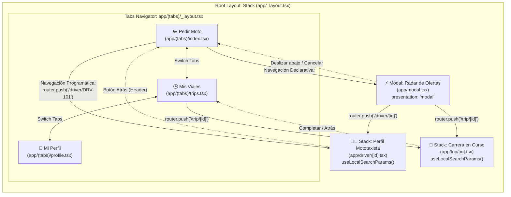

# Arquitectura y Documentación Técnica — MotoYa 🏍️

Documento técnico de diseño de software y navegación para **MotoYa**, aplicación móvil de servicio urbano de mototaxis estilo inDriver construida con **Expo Router** y **React Native**.

---

## 1. Wireframe y Mapa de Navegación

### Preguntas Fundamentales de Diseño

1. **¿Cuáles son las pantallas principales en la barra inferior (Tabs)?**
   - **Pedir Moto (`app/(tabs)/index.tsx`)**: Dashboard interactivo donde el pasajero ingresa su origen, destino, selecciona el tipo de servicio (Estándar, Express, Con Parrilla), propone su tarifa en COP y selecciona el método de pago (Efectivo, Nequi, Daviplata).
   - **Mis Viajes (`app/(tabs)/trips.tsx`)**: Registro cronológico de carreras finalizadas y activas con opción de seguimiento.
   - **Mi Perfil (`app/(tabs)/profile.tsx`)**: Información del pasajero, medios de pago vinculados y switch para activar el *Modo Conductor*.

2. **¿Qué pantalla requiere presentarse de manera jerárquica con botón de regreso (Stack)?**
   - **Expediente del Conductor (`app/driver/[id].tsx`)** y **Monitoreo de Carrera (`app/trip/[id].tsx`)**: Se apilan en el *Root Stack* con cabecera nativa activa (`headerShown: true`) y botón de regreso (`‹ Volver`) para regresar a la vista anterior.

3. **¿Qué pantalla muestra contenido dinámico dependiente de un identificador único (Ruta Dinámica `[id]`)?**
   - `driver/[id].tsx`: Recibe el identificador único del mototaxista (ej. `DRV-101`) y mediante `useLocalSearchParams` extrae sus datos, modelo de moto y antecedentes.
   - `trip/[id].tsx`: Recibe el identificador de la carrera activa (ej. `TRP-301`) y despliega el PIN de seguridad, la telemetría y el botón SOS.

4. **¿Qué flujo justifica una apertura de tipo Modal?**
   - **Radar de Ofertas (`app/modal.tsx`)**: Cuando el pasajero hace clic en *Buscar MotoTaxi*, se abre una ventana modal nativa (`presentation: 'modal'`). Justifica su naturaleza modal porque es un proceso transitorio de negociación y subasta en vivo que permite comparar y aceptar ofertas sin destruir el contexto de la solicitud inicial.

---

### Diagrama de Navegación (Mermaid)



---

## 2. Explicación del Flujo Técnico

1. **Root Stack (`app/_layout.tsx`)**:
   Orquesta la pila nativa integrando `<SafeAreaProvider>` y registrando `(tabs)`, el modal `modal` con `presentation: 'modal'` y las dos rutas dinámicas `driver/[id]` y `trip/[id]`.
2. **Tab Navigator (`app/(tabs)/_layout.tsx`)**:
   Implementa 3 pestañas funcionales con iconos vectoriales de `@expo/vector-icons` (`Ionicons`), estilizado ergonómico y cápsulas de enfoque activo.
3. **Navegación Declarativa vs. Programática**:
   - **Declarativa con `<Link>`**: El botón *"Buscar MotoTaxi por $3.500"* en `RideRequestScreen.tsx` utiliza `<Link href="/modal" asChild>` para disparar el modal de ofertas de forma semántica y accesible.
   - **Programática con `router.push()`**: Al pulsar en *"Ver Moto"* o *"Aceptar Carrera"*, se dispara `router.push('/driver/DRV-101')` o `router.push('/trip/TRP-301')`, enviando el ID dinámico a través de código.
4. **Captura de Parámetros Dinámicos**:
   Tanto en `DriverDetailScreen.tsx` como en `TripDetailScreen.tsx` se importa `useLocalSearchParams<{ id: string }>()`, capturando el parámetro `id` e imprimiéndolo en un contenedor destacado.

---

## 3. Arquitectura Feature-First y Separación de Conceptos

La estructura separa estrictamente las **rutas** de la **lógica del negocio**:

- `app/` contiene exclusivamente definiciones delgadas de ruteo que reexportan las pantallas reales:
  ```tsx
  export { default } from '@/features/ride/RideRequestScreen';
  ```
- `src/features/` organiza el código por dominio funcional:
  - `ride/`: Solicitud, negociación de precio y radar de contraofertas.
  - `driver/`: Ficha del mototaxista y requisitos de seguridad.
  - `trips/`: Monitoreo en vivo y registro de viajes.
  - `profile/`: Perfil de usuario y medios de pago.
- `src/components/`: Componentes modulares reutilizables (`Card`, `Badge`, `FareCounter`).
- `src/theme.ts`: Tokens de diseño centralizados (paleta verde inDriver, sombras y radios).
